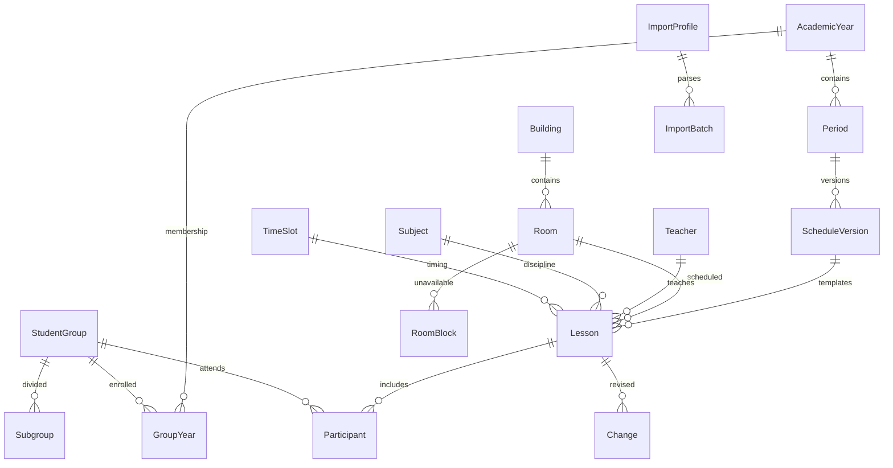

# Данные и алгоритмы

## Слои

`models.py` задаёт структуру и валидацию отдельных сущностей. `services.py` содержит единый расчёт итогового расписания и транзакционные команды. `importing.py` преобразует XLSX в нормализованные строки и вызывает те же команды публикации. HTTP API и Django Admin используют этот сервисный слой. Frontend получает готовые DTO, не реализует правила замен.

## Связи

Имена таблиц имеют стандартный префикс `schedule_`; соответствуют сущностям ТЗ. Все основные связи типизированы внешними ключами. JSON используется для конфигурации профиля, предварительных строк импорта и снимков аудита, а не как основное хранилище занятий. Ссылки защищены `PROTECT`, участники удаляются каскадно только вместе с черновым занятием на уровне ORM; обычное удаление в панели отключено.

Учитель хранится одним полным отображаемым именем, а поиск разбивает его и запрос на слова, поддерживая частичное совпадение и инициалы. Помещение уникально по корпусу и номеру. Группа имеет стабильное имя и состав `GroupYear` с курсом/статусом для каждого года. Специальность, подгруппа и тип аудитории — отдельные справочники.

## Расписание на дату

1. Выбираются опубликованные версии, чьи диапазоны включают дату. Версии колледжа ограничены связью `groups`: для каждой группы побеждает последняя публикация, расписания остальных курсов сохраняются. Пустой список groups означает общую полную версию для совместимости с универсальными профилями.
2. Применяются праздник, замена дня недели и явно заданный тип недели из `CalendarDay`.
3. `timing.week_info` чередует первую/вторую недели от `AcademicYear.week_anchor_date` и `week_anchor_number`. Без опорной даты используется понедельник начала года; календарное исключение меняет только свою дату. Строки odd/even сохранены в БД для совместимости и означают первую/вторую недели, а не номер недели ISO.
4. Загружаются соответствующие регулярные занятия. Общий расчёт `timing` применяет `WeekdayBell` по фактическому дню недели с запасным вариантом `TimeSlot`, затем `ShortenedDay` для особой даты. Своё время занятия/замены имеет высший приоритет. Этот же расчёт используется для переносов, свободных интервалов, сетки кабинетов и проверки конфликтов.
5. Для каждой области «исходное занятие + исходная дата + целевая группа + целевая подгруппа» выбирается последняя опубликованная замена. `split_change_target` сохраняет остальных участников и подгруппы. Черновики и отозванные записи игнорируются. Замены старой, вытесненной на исходную дату версии не применяются.
6. Отмена остаётся видимой, но не занимает ресурсы; перенос оставляет исходную отметку и появляется в новую дату; дополнительное занятие не требует шаблона.
7. Активные включительные диапазоны `PracticePeriod` удаляют из итоговых участников только группы на практике. После окончания диапазона расчёт автоматически возвращает обычные пары. Результат сортируется по точному времени. Представления фильтруют его по группе, преподавателю или аудитории; публичная неделя содержит шесть учебных дней.

Публикация новых полных версий не переносит автоматически замены, привязанные к старым шаблонам. Это предотвращает применение замены к неверному занятию. После импорта проверьте необходимые будущие замены и создайте их для новой версии.

`curriculum.py` собирает учебные предметы (`Subject.is_curricular`) и преподавателей из актуального опубликованного снимка выбранной группы и учебного периода сразу для обеих недель. Классные часы остаются занятиями, но не дисциплинами. При отсутствии снимка на дату выбирается ближайший в пределах периода. Семестр можно добавить после импорта: учитываются пересекающиеся версии того же учебного года. Изображения сначала сопоставляются с группой, затем с этим ограниченным словарём. Строгая функция `resolve_candidates` сохраняет отказ от неоднозначности; `infer_row` ранжирует предложения для проверки, использует связь предмета с преподавателем и исходную пару, отмечает догадки. Формы повторяют ограничение словаря на сервере, клиент обновляет варианты при смене группы. Публикация требует выбранных человеком строк.

`lesson_windows` ищет свободные целые пары строго между первым и последним занятиями. `free_intervals` отдельно вычисляет свободное время кабинетов, включая перемены. `operations.py` содержит формы для повседневной настройки звонков и практик; доступ к моделям для точных изменений вынесен в `/admin/advanced/`.

## Конфликты

Полуоткрытые интервалы `[start,end)` пересекаются, если `startA < endB && startB < endA`. Номер пары не используется вместо времени. Для пересекающихся занятий проверяются одинаковые аудитории и преподаватели, а также одинаковые группы. Разные непустые подгруппы одной группы совместимы; вся группа конфликтует с любой своей подгруппой. Проверяются деактивированные помещения/корпуса, временные блокировки и отсутствие учебного периода.

Публикация версии проверяет каждую дату её действия, участников и активность групп в её году. Публикация замены проверяет исходную/новую дату, принадлежность исходного занятия актуальному расписанию и активность участников. Критические конфликты блокируют публикацию без механизма принудительного исключения.

Все команды публикации используют транзакцию. PostgreSQL блокирует общий набор строк учебных годов для сериализации конкурирующих публикаций; SQLite сериализует записи средствами БД. При SQLite и интенсивном одновременном редактировании возможен отказ `database is locked`; повторите операцию либо используйте PostgreSQL. Проверять производственную конкуренцию следует на PostgreSQL.

## История и откат

Новые версии не перезаписывают прежние. Для отката версия переводится в архив, вновь действует предыдущая подходящая публикация. Если её нет, отображается «Нет данных». Откат замен возвращает предыдущую редакцию либо базовое занятие. Откат, создающий конфликт, блокируется транзакционно.

Журнал хранит автора, действие, сущность, время и снимки полей для изменений через панель; специальные команды дополнительно регистрируют смену статуса/связь с версией. Прямые изменения SQL или ORM вне предусмотренных команд обходят правила: используйте сервисный слой.

## Расширение

Новые форматы импорта добавляются обработчиками с результатом в стандартных полях `FIELDS`. API можно версионировать префиксом `/api/v2/`, сохраняя DTO v1. Для уведомлений и интеграций используйте зарегистрированные успешные публикации; не отправляйте внешние события до завершения транзакции. Бронирование, автоматическое составление расписаний и отслеживание фактического присутствия не реализованы согласно ограничениям первой версии ТЗ.
