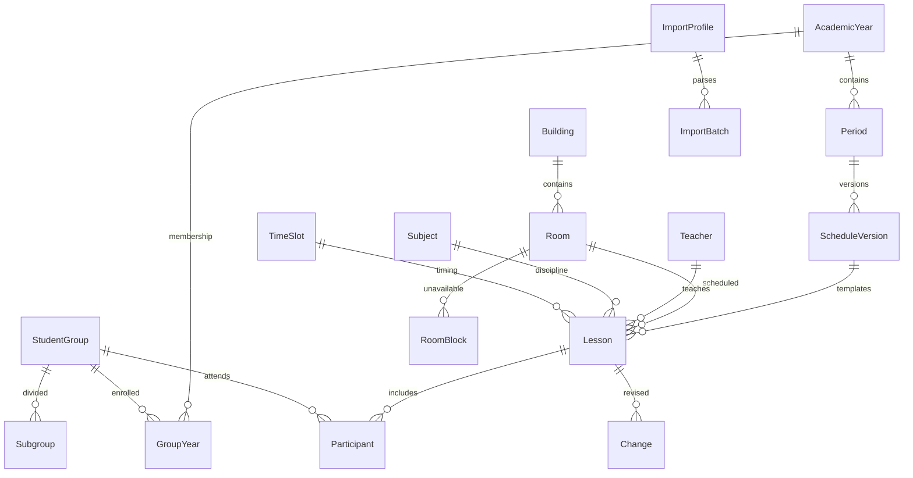

# Данные и алгоритмы

## Слои

`models.py` задаёт структуру и валидацию отдельных сущностей. `services.py` содержит единый расчёт итогового расписания и транзакционные команды. `importing.py` преобразует XLSX в нормализованные строки и вызывает те же команды публикации. HTTP API и Django Admin используют этот сервисный слой. Frontend получает готовые DTO, не реализует правила замен.

Публичные расписания дополняются `annotate_joint_groups` до фильтрации по выбранной сущности. `joint_groups` описывает совместное посещение, сохраняя исходные `groups` и `original` каждой записи. Одинаковые время, преподаватель и кабинет объединяют отдельные записи только при обоих точных разрешениях пересечений; для совместных кураторских часов используется то же правило совпадения, что и при проверке конфликтов. Для участников одного базового занятия дополнительных разрешений не требуется. Учитываются практика, отмены и текущая редакция. Представление карточки выводит исходную пару и остальных участников явно; сведения о разрешениях остаются внутренними.

## Связи

Имена таблиц имеют стандартный префикс `schedule_`; соответствуют сущностям ТЗ. Все основные связи типизированы внешними ключами. JSON используется для конфигурации профиля, предварительных строк импорта и снимков аудита, а не как основное хранилище занятий. Ссылки защищены `PROTECT`, участники удаляются каскадно только вместе с черновым занятием на уровне ORM; обычное удаление в панели отключено.

Учитель хранится одним полным отображаемым именем, а поиск разбивает его и запрос на слова, поддерживая частичное совпадение и инициалы. Помещение уникально по корпусу и номеру. Группа имеет стабильное имя и состав `GroupYear` с курсом/статусом для каждого года. Специальность, подгруппа и тип аудитории — отдельные справочники.

## Расписание на дату

1. Выбираются опубликованные версии, чьи диапазоны включают дату. Версии колледжа ограничены связью `groups`: для каждой группы побеждает последняя публикация, расписания остальных курсов сохраняются. Пустой список groups означает общую полную версию для совместимости с универсальными профилями.
2. Применяются праздник, замена дня недели и явно заданный тип недели из `CalendarDay`.
3. `timing.week_info` чередует первую/вторую недели от `AcademicYear.week_anchor_date` и `week_anchor_number`. Без опорной даты используется понедельник начала года; календарное исключение меняет только свою дату. Строки odd/even сохранены в БД для совместимости и означают первую/вторую недели, а не номер недели ISO.
4. Загружаются соответствующие регулярные занятия. Общий расчёт `timing` применяет `WeekdayBell` по фактическому дню недели с запасным вариантом `TimeSlot`, затем `ShortenedDay` для особой даты. `ShortenedBell` хранит необязательные длительности пар и перемен после них; null означает наследование общих настроек, ноль перемены — отсутствие перерыва. Своё время занятия/замены имеет приоритет для действующих пар. `lesson_count` ограничивает их номера; пары выше лимита скрываются независимо от своего времени. Этот же расчёт используется для переносов, свободных интервалов, сетки кабинетов и проверки конфликтов. Старые сокращённые дни с `lesson_count=null` сохраняют прежний набор звонков.
5. Для каждой области «исходное занятие + исходная дата + целевая группа + целевая подгруппа» выбирается последняя опубликованная замена. `split_change_target` сохраняет остальных участников и подгруппы. Черновики и отозванные записи игнорируются. Замены старой, вытесненной на исходную дату версии не применяются.
6. Отмена остаётся видимой, но не занимает ресурсы; перенос оставляет исходную отметку и появляется в новую дату; дополнительное занятие не требует шаблона.
7. Активные включительные диапазоны `PracticePeriod` удаляют из итоговых участников только группы на практике. После окончания диапазона расчёт автоматически возвращает обычные пары. Результат сортируется по точному времени. Представления фильтруют его по группе, преподавателю или аудитории; публичная неделя содержит шесть учебных дней.

Публикация новых полных версий не переносит автоматически замены, привязанные к старым шаблонам. Это предотвращает применение замены к неверному занятию. После импорта проверьте необходимые будущие замены и создайте их для новой версии.

`curriculum.py` собирает учебные предметы (`Subject.is_curricular`) и преподавателей из актуального опубликованного снимка выбранной группы и учебного периода сразу для обеих недель. Классные часы остаются занятиями, но не дисциплинами. При отсутствии снимка на дату выбирается ближайший в пределах периода. Семестр можно добавить после импорта: учитываются пересекающиеся версии того же учебного года. Изображения сначала сопоставляются с группой, затем с этим ограниченным словарём. Строгая функция `resolve_candidates` сохраняет отказ от неоднозначности; `infer_row` ранжирует предложения для проверки, использует связь предмета с преподавателем и исходную пару, отмечает догадки. Формы повторяют ограничение словаря на сервере, клиент обновляет варианты при смене группы. Публикация требует выбранных человеком строк.

`lesson_windows` ищет свободные целые пары строго между первым и последним занятиями. `free_intervals` отдельно вычисляет свободное время кабинетов, включая перемены. В публичном расписании кабинета выводится `free_slots`: только целые интервалы номерных звонков дня, полностью входящие в свободное время. Поэтому перемены и частично свободные пары не отображаются; сокращения и блокировки сохраняют действие. Для недоступных помещений и отсутствующих данных список пуст. `operations.py` содержит формы для повседневной настройки звонков и практик; доступ к моделям для точных изменений вынесен в `/admin/advanced/`.

Сокращённый день и его строки сохраняются одной транзакцией. `_pending_bells` передаёт в валидацию будущий набор строк: изменение большого перерыва вместе со временем начала проверяется по новым данным, а не по ещё сохранённым старым значениям. Копирование дня создаёт несохранённую форму с пустой датой, исходная запись сохраняется. Клиентский `short-day.js` считает предварительные интервалы без отправки формы; серверный расчёт остаётся обязательным и независимым.

## Конфликты

Полуоткрытые интервалы `[start,end)` пересекаются, если `startA < endB && startB < endA`. Номер пары не используется вместо времени. Для пересекающихся занятий проверяются одинаковые аудитории и преподаватели, а также одинаковые группы. Разные непустые подгруппы одной группы совместимы; вся группа конфликтует с любой своей подгруппой. Проверяются деактивированные помещения/корпуса, временные блокировки и отсутствие учебного периода.

Публикация версии проверяет каждую дату её действия, участников и активность групп в её году. Публикация замены проверяет исходную/новую дату, принадлежность исходного занятия актуальному расписанию и активность участников. Конфликты блокируют публикацию. В строке проверки изображения можно отдельно подтвердить пересечение кабинета и преподавателя между конкретными занятиями. Неподтверждённые конфликты, пересечения групп, блокировки и недоступность кабинета продолжают блокировать публикацию.

Все команды публикации используют транзакцию. PostgreSQL блокирует общий набор строк учебных годов для сериализации конкурирующих публикаций. SQLite использует WAL для одновременного чтения и записи и `transaction_mode=IMMEDIATE`, чтобы получить блокировку до чтений внутри транзакции и избежать конфликтующего повышения блокировки; ожидание другого писателя ограничено 20 секундами. SQLite всё ещё допускает только одного писателя. Подробнее: [Django 5.2, SQLite](https://docs.djangoproject.com/en/5.2/ref/databases/#database-is-locked-errors). Производственное развёртывание использует PostgreSQL.

Единственная точка входа предпросмотра — `import_report`. На SQLite `previewing.py` создаёт согласованный снимок через Online Backup API; если вызывающий код уже в транзакции, копируется видимый ему SQL-дамп без попытки резервирования пишущего соединения. `preview_worker.py` запускается без оболочки, получает только путь отдельной копии и номер импорта и перенастраивает Django до открытия соединений. `_calculate_import_report` материализует временную версию и проверяет её теми же сервисами внутри откатываемой транзакции. В SQLite эта транзакция существует только в копии; в PostgreSQL выполняется напрямую. Рабочая БД не получает временных записей SQLite. Процесс ограничен 180 секундами, копирование — 20 секундами; временная папка удаляется и после ошибки. Прерывание проверки возвращает 503 с повторной попыткой, публикация всегда повторно проверяет основную БД.

## История и откат

Новые версии не перезаписывают прежние. Для отката версия переводится в архив, вновь действует предыдущая подходящая публикация. Если её нет, отображается «Нет данных». Откат замен возвращает предыдущую редакцию либо базовое занятие. Откат, создающий конфликт, блокируется транзакционно.

Журнал хранит автора, действие, сущность, время и снимки полей для изменений через панель; специальные команды дополнительно регистрируют смену статуса/связь с версией. Прямые изменения SQL или ORM вне предусмотренных команд обходят правила: используйте сервисный слой.

## Расширение

Новые форматы импорта добавляются обработчиками с результатом в стандартных полях `FIELDS`. API можно версионировать префиксом `/api/v2/`, сохраняя DTO v1. Для уведомлений и интеграций используйте зарегистрированные успешные публикации; не отправляйте внешние события до завершения транзакции. Бронирование, автоматическое составление расписаний и отслеживание фактического присутствия не реализованы согласно ограничениям первой версии ТЗ.

## Кураторские часы и фрагменты OCR

`CuratorBell` хранит время двух понедельничных смен. `Lesson.curator_shift` относится к конкретной строке Excel и неделе, а не вычисляется по первой обычной паре группы. Парсер предварительно индексирует номерные пары: ненумерованная строка перед первой парой получает день и неделю следующего блока, строка перед четвёртой — вторую смену. Исторические названия и известные опечатки приводятся к «Разговорам о важном», `Subject.is_curricular=False`. Одинаковые куратор, кабинет, дисциплина, смена и интервал у разных групп из отдельных курсовых файлов означают совместный час; пересечения самих участников продолжают проверяться.

`ImageImport.payload` дополнен `source_box`, `row_box`, `group_box` в исходных пикселях и `ocr_attempts`. Второй проход изолирует до 12 сложных ячеек, сохраняет варианты текста и заменяет предложение только при улучшении полноты/качества сопоставления. Координаты приватных PNG берутся исключительно из сохранённого анализа и проверяются по размеру оригинала. Повторный анализ не публикует замены; статус повторно проверяется под блокировкой после OCR, чтобы не изменить уже завершённый импорт.

`ImageReviewConflicts` сохраняет номера исходных строк формы, оба DTO занятий и точный интервал после отката транзакции. Пустые и удалённые строки не перенумеровываются. `allow_room_overlap` и `allow_teacher_overlap` — независимые поля формы. После расчёта всего набора сервис сохраняет конкретные разрешённые пары в `Change.room_overlap_approvals` и `Change.teacher_overlap_approvals`. Общий отпечаток занятия `room_overlap_key` связывает каждое разрешение с датой, временем, участниками, ресурсами, идентификаторами занятия и редакции замены. Другая редакция или новое занятие не наследует исключение. Оба поля недоступны для произвольной записи через API или техническую форму. Изменение данных строки снимает обе галочки; массовое выделение не выставляет их.

По умолчанию `conflicts_for` возвращает блокирующие конфликты; `include_allowed=True` добавляет разрешённые пересечения с `allowed=True`. Разрешения проверяются из БД в той же транзакции и не передаются в публичных DTO. Выдача занятости кабинета сохраняет оба занятия. Журнал публикации хранит автора и описание разрешённой пары.

`room_matching.py` отделяет номера кабинетов от нестрогого сопоставления названий предметов. Шаблоны строятся по существующим обозначениям с ограниченными заменами похожих OCR-символов; числовой префикс не исправляется через общий Levenshtein/SequenceMatcher. Инициалы преподавателя и номера модулей не используются как номера кабинетов. История кабинетов выбранного предмета и преподавателя сначала фильтруется по `week_info(target_date)`, затем по дню и паре; исходная пара берётся из `base_schedule(target_date)`. Если приходится использовать историю другой недели или неполное обозначение, предположение явно отмечается. Список предметов остаётся семестровым, чтобы разрешать замену предметом из другой недели.

`bell-editor.js` считает каскад времени только от редактируемой строки вперёд. Начало задаёт окончание через общую длительность, изменение окончания сохраняет собственную длительность этой пары, перемена сдвигает следующую. Перенос начала третьей пары обновляет величину паузы после второй, сохраняя время первых двух. Сохранённые длинные паузы не теряются. Клиент отправляет обычные интервалы `BellRowForm`, поэтому существующие серверные проверки порядка, пересечений и границ дня остаются обязательными. На открытие формы и предварительный расчёт нет записей в БД.

## Документы и ручные операции

`exports.py` строит одну модель таблиц для печатного HTML и Word; `word_export.py` — независимый от Django генератор OOXML на стандартной библиотеке. На сервере не нужны Office, LibreOffice или новые Python-зависимости. Таблицы имеют фиксированные колонки, переносы текста, повторяемый заголовок и автоматическую высоту строк, A4 в альбомной ориентации. Обычная выгрузка использует `schedule_on`, исходные DTO, совместных участников и периоды практики. Базовая — опубликованную версию выбранного периода, её тип недели и обычные звонки. Пустые внутренние пары сохраняются, отсутствие данных отличается от отсутствия занятия.

Ручной ввод использует `ImageImport(layout=manual,image='')` как сохраняемый пакет, существующие формы проверки и атомарный `publish_review`. Редактирование строк не создаёт опубликованных Change. Ссылки на исходное изображение и повторное OCR для ручных пакетов скрыты; запрос исходника возвращает 404. Добавление строк сохраняет bound POST, ограничение 250 форм и исходную нумерацию.

`RoomCampus` задаёт ручную визуальную группировку, `Room.campus` и существующий `floor` отделены от технического `building`: переназначение не меняет права доступа, уникальность номера и распознавание импорта. Сохранение выполняется общей транзакцией с аудитом каждой изменённой записи. XLSX materialize не перезаписывает эти поля.
